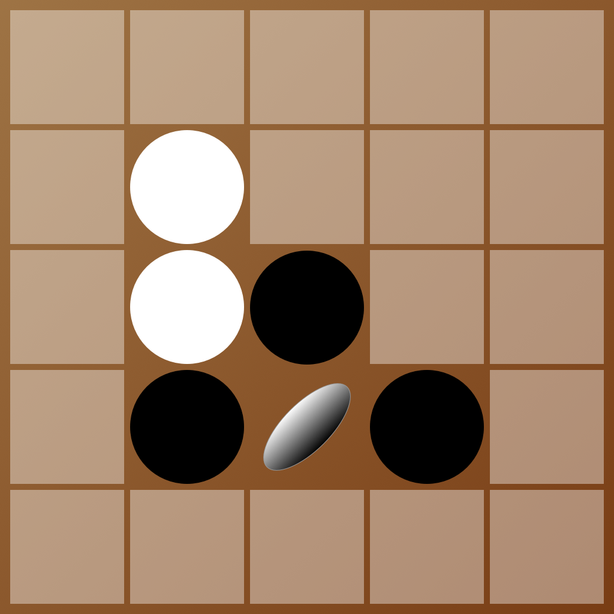

<p align="center">
  
</p>

<h1 align="center">Classic Reversi (Othello)</h1>

<p align="center">
  A clean, classic Reversi/Othello game built with Flutter for iOS, Android, and macOS.
</p>

<p align="center">
  <a href="https://apps.apple.com/us/app/classic-reversi-othello-game/id1616580829">
    
  </a>
</p>

## Features

- **Five difficulty levels** — Super Easy uses a smaller 6×6 board; Easy, Medium, Hard, and Premium Expert play on the classic 8×8 board. Expert uses a time-boxed iterative-deepening search that solves endgames exactly. New players start on Easy.
- **Save and continue** — unfinished games, computer turns, and undo history are saved after each move and restored across launches.
- **Guided practice** — learn captures, turns, and corner strategy by playing short interactive lessons.
- **Match library** — keep the latest 100 completed games with dates, results, board previews, and move-by-move replay.
- **Strategy coach** — explore suggested moves, revisit a possible turning point, and practice a position without affecting your saved game.
- **Coach tips** — mark a strong move on the board mid-game with the reasons behind it; three free tips a day, then an optional rewarded ad.
- **Game analysis** — Premium players see per-player accuracy and the key moments of every finished game in Review.
- **Curated puzzles** — build corner, forced-pass, and endgame skills through nine exercises with progressive hints and saved progress.
- **Choose who goes first** — play as Black, let the computer open, or leave it to chance.
- **Local 2-player mode** — pass-and-play against a friend on the same device.
- **Undo and legal move hints** — available directly on easier levels, with rewarded options on harder levels; Premium makes undo unlimited.
- **Daily challenges and achievements** — play a daily position and see progress toward wins, streaks, and your next milestone.
- **Shareable result cards** — preview and share a PNG of the final board, score, mode, and date.
- **Premium** — a one-time purchase on the App Store and Google Play: no ads, unlimited undo and coach tips, hints, Expert, game analysis, and two extra board themes.
- **Accessible play** — descriptive board cells, keyboard navigation, turn announcements, larger text, reduced motion, and five board themes.
- Responsive layouts for phones, tablets, and resizable Mac windows, with clear turn/pass messages and restart protection.
- **Mac App Store** — the macOS app has no ads; extras that are ad-gated on mobile (hints, harder-level undo, extra coach tips) come with Premium, shared with iOS through universal purchase.

## Tech stack

- [Flutter](https://flutter.dev) / Dart
- Alpha-beta minimax with a positional heuristic for the CPU opponent (see `lib/move_finder.dart`, `lib/game_board_scorer.dart`), plus a mailbox-board Expert engine (`lib/expert_engine.dart`)
- `google_mobile_ads` for banner, app-open, and rewarded ads
- `in_app_purchase` for the Premium one-time purchase
- `shared_preferences` for local persistence (difficulty, first-player choice, win/loss record)
- `in_app_review` for store review prompts

## Getting started

```bash
git clone https://github.com/banghuazhao/classic_reversi.git
cd classic_reversi
flutter pub get
flutter run
```

Run the test suite with:

```bash
flutter test
```

Render the Mac App Store screenshots (2880×1800) from the real macOS app into `build/mac_store_screenshots`:

```bash
flutter drive -d macos --driver=test_driver/integration_test.dart --target=integration_test/mac_store_screenshots_test.dart
```

## Project structure

```
lib/
├── main.dart              # App entry point, navigation, game screen
├── start_screen.dart       # Difficulty / first-player / 2-player setup screen
├── game_model.dart         # Immutable game state (board + whose turn)
├── game_board.dart         # Board representation, legal move & flip logic
├── game_board_scorer.dart  # Positional heuristic used by the AI
├── move_finder.dart        # Minimax search / difficulty-based move selection
├── expert_engine.dart      # Expert iterative-deepening search
├── strategy_coach.dart     # Move suggestions, coach tips, game analysis
├── premium_screen.dart     # Premium benefits and purchase / restore
├── game_settings.dart      # Difficulty / first-player enums
├── settings_service.dart   # Persisted settings & win/loss record
├── styling.dart            # Shared colors, gradients, and text styles
└── Tools/                  # Ads, purchases, and in-app review helpers
```

## Contributing

Issues and pull requests are welcome.
